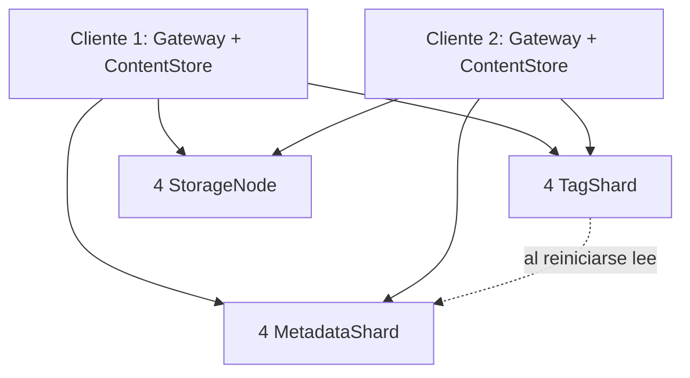
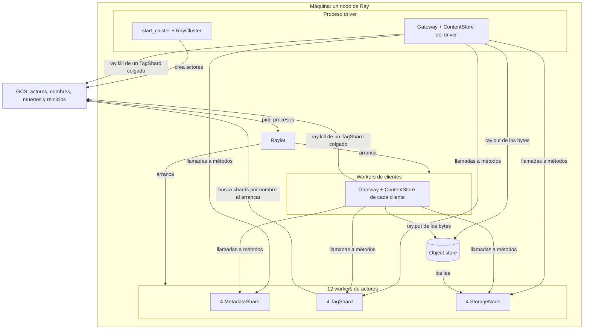

# Distributed-Tag-Based-File-System

Sistema distribuido para guardar archivos y buscarlos por etiquetas con
expresiones booleanas. Los metadatos de cada archivo son la fuente de verdad y
el índice de etiquetas se deriva de ellos. Los bytes se identifican por su
SHA-256 y se replican en varios nodos elegidos con hashing consistente.

Este repositorio es la Fase 1: un prototipo pequeño sobre Ray para entender el
dominio, fijar el contrato externo y averiguar qué mecanismos distribuidos
tendrá que construir la versión nativa. Todo el estado vive en memoria.

## Ejecutar

Requiere Python 3.10 o posterior; `pyproject.toml` fija Ray 2.60.0. Probado con
Python 3.13.7 en una sola máquina con Windows.

```console
python -m venv .venv
.venv\Scripts\activate          # Linux/macOS: source .venv/bin/activate
python -m pip install -e ".[test]"
python -m pytest -q             # suite completa, unos 8 minutos
python -m pytest tests/unit -q  # solo la lógica, sin Ray
python scripts/demo.py          # operaciones, fallos, partición y concurrencia
python scripts/demo_clients.py  # varios clientes a la vez y el proceso de cada actor
```

Ray arranca un clúster local: son varios procesos en la misma máquina, no varias
máquinas.

## Contrato externo

Es lo que la versión nativa debe conservar. Está escrito como pruebas en
[tests/gateway_contract.py](tests/gateway_contract.py), que se ejecutan dos veces:
sin Ray, con shards locales ([tests/unit/test_gateway.py](tests/unit/test_gateway.py)),
y con actores reales ([tests/integration/test_contract.py](tests/integration/test_contract.py)).

```python
from tagfs.ray_runtime import start_cluster, stop_cluster

cluster = start_cluster()       # arranca Ray si hace falta y crea los actores
gateway = cluster.gateway()     # cada cliente crea el suyo
file_id = gateway.put("nota.txt", b"hola", {"Documento", "trabajo"})
gateway.query("documento AND NOT borrador")  # [file_id]
stop_cluster()
```

| Operación | Resultado |
| --- | --- |
| `put(name, content, tags=())` | Crea un archivo y devuelve su ID. `content` debe ser `bytes` |
| `get(file_id)` | Devuelve `StoredFile(name, content, tags, version)`, que también se puede usar como tupla |
| `add_tags(file_id, tags)` | Agrega etiquetas y devuelve la versión resultante |
| `remove_tags(file_id, tags)` | Quita etiquetas y devuelve la versión resultante |
| `rename(file_id, new_name)` | Cambia el nombre y devuelve la versión resultante |
| `delete(file_id)` | Elimina el archivo de forma lógica |
| `query(expr)` | Devuelve, ordenados, los IDs que cumplen la expresión |
| `list()` | Devuelve, ordenados, los IDs de todos los archivos vivos |
| `collect_garbage()` | Borra el contenido que ya no usa ningún archivo y dice cuántos borró |
| `reconcile()` | Repara la ubicación de las copias tras fallos o particiones y devuelve un informe |
| `repair_index()` | Entrega al índice los cambios pendientes y dice cuántos entregó |
| `verify_index()` | Compara el índice con los metadatos sin cambiar nada: devuelve lo que falta (`missing`) y lo que sobra (`extra`) |

Reglas:

- Cada `put` genera un ID nuevo, aunque el nombre y los bytes se repitan. Dos
  archivos pueden compartir los mismos bytes y tener metadatos independientes.
- La versión empieza en 1 y sube con cada cambio efectivo. Agregar una etiqueta
  que ya está, quitar una que no está o repetir el nombre no la cambia.
- Las etiquetas se guardan en minúsculas. Se rechazan las vacías, las que tienen
  espacios o paréntesis y las palabras `and`, `or` y `not`.
- Las consultas admiten `AND`, `OR`, `NOT` y paréntesis, y cada rama necesita una
  parte positiva: `foto AND NOT borrador` vale, `NOT borrador` no.
- Repetir `delete` sobre un archivo eliminado no cambia nada. Eliminar no borra
  los bytes al momento, porque otro archivo puede usarlos; lo hace la recolección.
- Un cambio queda hecho cuando lo aceptan los metadatos. Si después el índice no
  responde, el cliente no recibe error; el cambio queda pendiente y las consultas
  no lo ven hasta que alguien llame a `repair_index()`.

Errores que ve el cliente:

| Error | Cuándo |
| --- | --- |
| `FileNotFound` | El archivo no existe, fue eliminado o el ID nunca existió |
| `InvalidTag`, `InvalidQuery` | La etiqueta o la consulta están mal formadas; no se guarda nada |
| `ContentNotFound` | La ficha existe, pero ninguna réplica alcanzable tiene los bytes |
| `ContentCorrupted` | Los bytes no coinciden con su hash |
| `StorageUnavailable` | Ningún almacén pudo guardar el contenido de un `put` |
| `ServiceUnavailable` | Un shard de metadatos que la operación necesita murió o no respondió en `metadata_timeout` (10 s), o un shard de etiquetas no respondió ni después de reiniciarlo. Si ocurre durante un cambio, el cambio puede haberse hecho o no |

Todos son subclases de `TagFSError` y ninguno es un tipo de Ray: el gateway
traduce los errores de Ray antes de que lleguen al cliente, así que el contrato
no cambia al quitar Ray.

## Arquitectura

No hay un servidor central. Cada cliente tiene su propio `Gateway`, que corre en
el proceso del cliente y habla directamente con los actores.

| Componente | Dónde corre | Responsabilidad | Estado que guarda |
| --- | --- | --- | --- |
| `Gateway` | En cada cliente | Coordina las operaciones de ese cliente | Handles de los actores y timeouts |
| `ContentStore` | En cada cliente, dentro de su gateway | Elige réplicas, verifica lecturas, repara y recolecta | Su propia vista de qué almacenes están vivos |
| `MetadataShard` | Actor | Guarda la ficha autoritativa de cada archivo | Fichas y outbox de cambios pendientes para el índice |
| `TagShard` | Actor que Ray reinicia | Relaciona etiquetas con archivos | Índice derivado, con la versión de cada entrada |
| `StorageNode` | Actor | Guarda los bytes por su hash | Contenido |



`start_cluster()` es la única forma de arrancar el sistema. Crea los actores una
vez y devuelve un `RayCluster` que se puede enviar a otros procesos; cada cliente
llama a `cluster.gateway()`. Por defecto hay 4 shards de metadatos, 4 de
etiquetas, 4 almacenes y factor de replicación 2. Los metadatos se reparten por
ID de archivo y el índice por etiqueta con [router.py](src/tagfs/router.py); el
contenido, con el anillo de [ring.py](src/tagfs/ring.py). `Gateway(metadata,
tags, content)` también acepta shards locales sin Ray, para probar la lógica.

Una escritura sigue estos pasos:

1. El gateway valida las etiquetas y genera el ID.
2. `ContentStore` calcula el SHA-256 y envía los bytes a las réplicas que indica
   el anillo. Si una falla, prueba con el siguiente nodo.
3. El shard de metadatos crea la ficha, apunta los cambios de índice (`IndexOp`)
   en su outbox y los devuelve.
4. El gateway envía los `IndexOp` a los shards de etiquetas. Si uno no responde
   en `index_timeout`, pide a Ray que lo reinicie y vuelve a esperar.
5. Si el índice confirmó, el gateway saca el cambio del outbox. Si no, el cambio
   se queda ahí para `repair_index()`.

Una consulta pide a la vez al índice los archivos de cada etiqueta positiva, lee
las fichas de los candidatos y se queda con los que cumplen la expresión según
sus etiquetas actuales. Así se descartan los falsos positivos de un índice
atrasado, pero no se recuperan los archivos que le falten.

### Procesos y piezas de Ray

Los componentes de arriba viven en procesos que crea y vigila Ray. Estas son
las piezas de Ray que intervienen:

| Pieza de Ray | Qué es | Qué hace en este sistema |
| --- | --- | --- |
| Driver | El proceso que llama a `start_cluster()`: el script de la demo o pytest | Es dueño de los actores: si termina, Ray los destruye todos. Guarda el `RayCluster` y puede ser también un cliente |
| Workers | Procesos de Python que arranca Ray | Uno por cada uno de los 12 actores, otro por cada cliente de `run_in_workers()` y otro para `_StartBarrier` |
| GCS | El registro central del clúster, en el nodo principal | Apunta cada actor y su nombre, detecta cuándo muere y ordena reiniciarlo. Atiende `ray.get_actor()` y `ray.kill()` |
| Raylet | Un proceso por máquina | Arranca los workers que pide el GCS y les asigna CPU; sin CPU libre, un actor no se coloca |
| Object store | Memoria compartida de cada máquina, gestionada por su raylet | Guarda los bytes del `ray.put` de `ContentStore` hasta que los leen las réplicas, y los resultados grandes |



En una ejecución local todo está en la misma máquina: un raylet, un object store
y el GCS. Con varias máquinas, cada una tendría su raylet y su object store, y el
GCS seguiría siendo uno solo.

De cada componente nuestro, en qué proceso vive y de qué pieza de Ray depende:

| Componente | Proceso | Depende de | Para qué |
| --- | --- | --- | --- |
| `start_cluster()` y `RayCluster` | Driver | GCS y raylet | Registrar los actores, darles nombre y esperar a que arranquen |
| `Gateway` | El del cliente: el driver o un worker de cliente | Workers de los actores | Llamar a sus métodos con `.remote()` y esperar con `ray.get` |
| `ContentStore` | El del cliente, dentro de su gateway | Object store | Enviar los bytes una sola vez aunque vayan a varias réplicas |
| `MetadataShard` | Su propio worker, uno por shard | Raylet | Que exista el proceso; si muere, nadie lo vuelve a arrancar |
| `TagShard` | Su propio worker, uno por shard | GCS | Reiniciarlo con el mismo handle y encontrar los shards de metadatos por nombre |
| `StorageNode` | Su propio worker, uno por almacén | Object store | Recibir los bytes del `ray.put` |
| Clientes de `run_in_workers()` | Un worker por cliente | Raylet | Arrancarlos a la vez; declaran `num_cpus=0` para no esperar CPU |
| `_StartBarrier` | Su propio worker | Raylet | Solo para pruebas y demos: que los clientes empiecen juntos |

Lo que hoy da por hecho el código y no da ningún componente nuestro: que los
actores tengan nombre (GCS), que un `TagShard` muerto vuelva (GCS) y que haya un
proceso para cada actor (raylet). La versión nativa tendrá que dar cada una de
estas cosas por su cuenta.

## Qué hace Ray en este prototipo

### Tasks y actores

Los actores son los 12 shards y almacenes que crea `start_cluster()`. `Gateway`
y `ContentStore` no son actores: son objetos normales dentro de cada cliente.

Las tasks son los clientes de las pruebas y de las demos. Cada una recibe el
`RayCluster` y crea su propio gateway. `run_in_workers()` los lanza y usa un
actor auxiliar, `_StartBarrier`, para que todos empiecen a la vez; solo existe
para las pruebas y las demos.

### Qué va en paralelo y qué en serie

Los clientes corren en procesos distintos, así que sus operaciones ocurren al
mismo tiempo de verdad y solo hacen cola en el actor que comparten. Dentro de
una operación también van en paralelo, porque se envían todas las peticiones
antes de esperar:

- la escritura de un contenido en sus réplicas;
- la lectura de varias réplicas, quedándose con la primera válida (`ray.wait`);
- la entrega de los `IndexOp` a los shards de etiquetas;
- las búsquedas de todas las etiquetas de una consulta;
- la lectura de las fichas de los candidatos, una llamada por shard;
- `list()`, `repair_index()` y `verify_index()`, que preguntan a todos los shards.

[test_parallel_requests.py](tests/integration/test_parallel_requests.py) lo
comprueba sin medir tiempos. Usa shards que no responden hasta recibir todas las
peticiones esperadas: si el gateway esperara cada respuesta antes de enviar la
siguiente, la prueba fallaría por timeout.

En serie van los pasos de una escritura (contenido, metadatos, índice y
confirmación), a propósito: los metadatos no deben apuntar a bytes que aún no
existen. Y cada actor atiende una llamada a la vez.

Esa serialización de los actores sostiene invariantes que la versión nativa
tendrá que garantizar por su cuenta:

| Invariante | Qué la garantiza hoy | Qué hará falta sin Ray |
| --- | --- | --- |
| Dos cambios sobre un archivo no se pisan y cada uno recibe su versión | El `MetadataShard` atiende una llamada a la vez | Exclusión mutua por shard o por archivo |
| El índice converge aunque los `IndexOp` lleguen desordenados, repetidos o de clientes distintos | La versión de cada `IndexOp`; cada `apply` es atómico porque el actor es secuencial | Un lock alrededor de `apply` |
| Un cambio pendiente no devuelve al índice un estado viejo | `pending()` calcula el estado actual de cada etiqueta dentro del actor | Leer y responder bajo el mismo lock |
| La recolección no borra los bytes de un `put` que aún no tiene ficha | Nada: quien la llama debe detener antes las escrituras de todos los clientes | Coordinar explícitamente `put` y recolección |

El experimento de 50 clientes sale bien porque el shard de metadatos del archivo
aplica los cambios uno detrás de otro, no porque la aplicación controle la
concurrencia.

### Datos

El único `ray.put` explícito está en `ContentStore`: los bytes se serializan una
vez aunque se envíen a varias réplicas. Como `ContentStore` corre en el cliente,
los bytes van del cliente al object store de Ray y de ahí a cada réplica, y en
una lectura vuelven del almacén al cliente, sin pasar por ningún intermediario.

Lo demás viaja como argumento o resultado de un método: nombres, etiquetas,
`FileMeta`, `Mutation`, `IndexOp`, conjuntos de IDs. Cada cliente espera sus
`ObjectRef` dentro de la misma operación; ninguno se guarda para después. Dos
datos más se mueven entre procesos: el `RayCluster`, con los handles de todos
los actores, viaja a cada cliente; y cada `TagShard` recibe los nombres de los
shards de metadatos, no sus handles, para poder volver a buscarlos con
`ray.get_actor()` cuando Ray lo reinicia.

| Estado | Disponible | Reconstruible | Durable |
| --- | --- | --- | --- |
| Metadatos y outbox | Mientras viva su shard | No: son la fuente de verdad y no tienen copia | No |
| Índice | Mientras viva su shard, y Ray lo reinicia | Sí: al reiniciarse se rellena desde los metadatos | No |
| Contenido | Mientras quede una réplica alcanzable | No: los bytes vienen del cliente y no se pueden recalcular | No |
| Vista de almacenes vivos | Mientras viva el cliente | Sí: cada gateway empieza con todos y `reconcile()` readmite los que vuelven | No |

### Recursos y placement

Los actores no declaran recursos ni estrategias de placement. En Ray 2.60, un
actor así necesita una CPU libre para colocarse, pero no la reserva mientras
vive. Los clientes de `run_in_workers()` declaran `num_cpus=0`, así que todos
pueden correr a la vez aunque haya pocas CPU; los de la sección 11 de la demo no
declaran nada y reservan una CPU cada uno, de modo que cuántos corren a la vez
depende de la máquina. Las pruebas arrancan Ray con 2 CPU.

Sin CPU, los actores no se pueden colocar y se quedan esperando. Se comprobó con
`start_ray(num_cpus=0)`: `start_cluster()` falla con `GetTimeoutError` al cumplirse
`WORKER_START_TIMEOUT_SECONDS` (120 s).

El placement no afecta a la corrección. Todos los accesos van por handles o por
nombre, y qué shard o almacén guarda cada clave lo decide la aplicación, no Ray.
Ray solo elige en qué proceso y en qué máquina corre cada actor. Sí afecta a la
garantía de replicación: nada impide que las dos réplicas de un contenido acaben
en la misma máquina, y en una ejecución local siempre lo están. El factor 2
protege contra la pérdida de un proceso, no de una máquina.

### Fallos y reintentos

| Proceso | Configuración | Qué pasa si muere |
| --- | --- | --- |
| Cliente (task) | `max_retries=0`; por defecto Ray la repetiría hasta 3 veces | Ray no la repite y quien la espera recibe `WorkerCrashedError`. Los demás clientes siguen |
| `TagShard` | `max_restarts=-1`, `max_task_retries=-1` | Ray lo arranca en otro proceso con el mismo handle, lo rellena desde los metadatos y repite las llamadas que estaban en curso |
| `MetadataShard` | Valores por defecto: ni reinicio ni reintentos | Sus archivos quedan inaccesibles y quien los pide recibe `ServiceUnavailable`. Es a propósito: un shard nuevo empezaría vacío y diría que sus archivos no existen |
| `StorageNode` | Valores por defecto | El `ContentStore` de cada cliente lo saca de su anillo al detectarlo; `reconcile()` lo readmite si vuelve |
| Proceso que llamó a `start_cluster()` | Los actores no son *detached* | Ray destruye todos los actores, porque pertenecen a ese proceso |

Además, si un `TagShard` no responde en `index_timeout` (5 s), el gateway lo mata
con `ray.kill(no_restart=False)` para que Ray lo reinicie. Un shard lento se trata
como uno muerto. Hay un detalle de Ray que condiciona el código: Ray no reinicia
un actor cuyo `__init__` falló, así que el `TagShard` se salta al arrancar los
shards de metadatos muertos; si no, perdería también las etiquetas de los vivos.

¿Es seguro repetir cada operación?

| Operación | Repetirla |
| --- | --- |
| `put` | No es seguro: cada repetición crea otro archivo con otro ID |
| `get`, `query`, `list`, `verify_index` | Seguro: solo leen |
| `add_tags`, `remove_tags`, `rename` | Seguro si nadie más toca el archivo entre medias; si alguien lo cambió, la repetición puede deshacer su cambio |
| `delete` | Seguro: la segunda vez no cambia nada |
| `repair_index` | Seguro: entregar dos veces un cambio no tiene efecto |
| `collect_garbage`, `reconcile` | Seguro, si no se cruzan con un `put` |
| `TagShard.apply`, `TagShard.lookup` | Seguro: la versión descarta duplicados y `lookup` solo lee |
| `StorageNode.put` | Seguro: la clave es el hash del contenido |

Esta tabla explica la configuración: el `TagShard` puede dejar que Ray repita sus
llamadas, y los clientes no, porque un `put` repetido crea un duplicado. Desactivar
el reintento de Ray no lo resuelve del todo: un cliente que reintenta por su
cuenta tras perder la respuesta también crea otro archivo.

Límites conocidos:

- No hay persistencia ni réplicas de los metadatos.
- Un shard de metadatos colgado, pero vivo, no se reinicia: cada operación que
  lo necesite falla con `ServiceUnavailable` tras `metadata_timeout` (10 s).
  `list()`, las consultas, la recolección y `repair_index()` los necesitan todos.
- Contenido y metadatos no se escriben de forma atómica: una caída entre los dos
  pasos deja bytes huérfanos hasta la siguiente recolección.
- `repair_index()` y `reconcile()` hay que llamarlos a mano.
- Una escritura se acepta en cuanto una réplica confirma, aunque falten otras.
- La recolección y la reconciliación no deben cruzarse con un `put` de ningún
  cliente, y nada lo impide.
- Cada cliente tiene su propia vista de qué almacenes están vivos. Dos clientes
  pueden no coincidir y colocar copias en sitios distintos hasta que alguien
  llame a `reconcile()`.
- Un contenido inaccesible durante un aislamiento vuelve a estar disponible
  cuando el almacén reaparece.

### Observabilidad

Lo que se puede observar hoy:

- Qué proceso ejecuta cada actor. Todos responden a `pid()`.
  [test_ray_cluster.py](tests/integration/test_ray_cluster.py) comprueba que los
  12 actores corren en 12 procesos distintos del script, y
  [demo_clients.py](scripts/demo_clients.py) imprime el PID de cada actor y de
  cada cliente.
- Un reinicio. La sección 8 de la demo muestra el PID del `TagShard` antes y
  después de matarlo, y el log de Ray avisa de que la llamada en curso falló y
  se repetirá en el actor nuevo.
- Que un cliente no se repite. Una prueba de `test_ray_cluster.py` hace que un
  cliente incremente un contador y mate su propio proceso; el contador queda en
  1, así que Ray no lo ejecutó otra vez.

Lo que falta: relacionar cada petición con su task, su intento, su proceso y su
nodo. Hoy no se puede saber cuántas veces repitió Ray una llamada concreta al
`TagShard` reiniciado ni qué petición del cliente correspondía. El siguiente paso
sería que cada operación lleve un `request_id` y que cliente y actores lo
registren junto con el ID de la task (`ray.get_runtime_context()`), el PID y el
nodo.

## Experimentos y resultados

Resultados de una ejecución de [scripts/demo.py](scripts/demo.py) y
[scripts/demo_clients.py](scripts/demo_clients.py) en una sola máquina. Las
pruebas de [fallos del índice](tests/integration/test_gateway_index_failures.py),
[particiones](tests/integration/test_partitions.py) y
[extremo a extremo](tests/integration/test_end_to_end.py) comprueban los mismos
escenarios con aserciones.

| Experimento | Qué se hace | Resultado observado |
| --- | --- | --- |
| Deduplicación | Dos archivos con los mismos bytes | IDs distintos y 2 copias del contenido en total. Al borrar uno, la recolección no borra nada; al borrar el otro, borra el contenido |
| Cae un almacén, factor 2 | `ray.kill()` a un `StorageNode` | 20 de 20 archivos legibles; un archivo nuevo se guarda con 2 copias |
| Cae un almacén, factor 1 | Lo mismo con una sola copia | 14 de 20 legibles; las 20 fichas siguen existiendo |
| Cae un shard del índice | `ray.kill(no_restart=False)` al `TagShard` de una etiqueta | Ray lo reinicia en otro proceso (PID 13084 → 32408); la consulta devuelve 21 archivos antes y después, también desde otro cliente |
| Un cliente cae a mitad de un cambio | El cliente muere después de que los metadatos aceptan un `put` y antes de avisar al índice | El archivo existe, pero la consulta no lo encuentra y falta 1 entrada en el índice. `repair_index()` desde otro cliente entrega 1 cambio y la consulta lo encuentra |
| Partición y vuelta | `disconnect()`, escrituras y un borrado, `reconnect()` y `reconcile()` | 19 de 19 legibles durante el aislamiento; al volver, 3 contenidos fuera de lugar; tras reconciliar, 5 copias escritas, 5 sobrantes y 1 contenido basura borrados, y 0 fuera de lugar |
| 50 clientes sobre un archivo | 50 tasks agregan una etiqueta distinta al mismo archivo | 50 etiquetas, versión final 51 y 50 versiones distintas, de 2 a 51 |
| 4 clientes en paralelo | Cada uno crea 25 archivos | 17 procesos distintos (script, 12 actores, 4 clientes); 100 archivos en 0,59 s, con los 4 activos a la vez durante 0,34 s; las consultas coinciden con lo calculado desde los metadatos |

`disconnect()` hace que el almacén rechace peticiones; no toca la red del sistema
operativo. Matar un actor simula la pérdida de un proceso, no de una máquina. Los
tiempos incluyen el arranque de tasks y el scheduling de Ray; no son una medida
de rendimiento.

### Experimento: un TagShard colgado

Se guardan archivos con una etiqueta, se cuelga el `TagShard` de esa etiqueta y
se consulta hasta obtener la respuesta correcta. El shard se cuelga con una
llamada que duerme una hora, enviada con `max_task_retries=0`. Sin esa opción,
Ray repetiría también el cuelgue en el actor nuevo y no se recuperaría nunca. Se
ejecuta 3 veces sin fallo (control) y 3 con fallo, con la configuración por
defecto: 4 shards de cada tipo, factor 2, `index_timeout` de 5 s.

Predicción, escrita antes de ejecutar nada:

| Medida | Control | Con fallo | Por qué |
| --- | --- | --- | --- |
| Tiempo hasta la primera consulta correcta | Menos de 0,1 s | Entre 7 y 10 s | El gateway espera `index_timeout` (5 s), mata el shard para que Ray lo reinicie y espera al actor nuevo: arrancar un proceso de Python, importar `tagfs` y leer los 4 shards de metadatos |
| Archivos perdidos | 0 | 0 | El actor nuevo rellena el índice desde los metadatos, que no se tocan |
| PID del shard | No cambia | Cambia | Ray arranca el actor en otro proceso |
| `verify_index()` al terminar | Sin diferencias | Sin diferencias | El índice reconstruido es exactamente el de los metadatos |
| Consulta a otro shard durante el cuelgue | Menos de 0,1 s | Igual que en el control | El gateway no pasa por el shard colgado |

Se ejecutó con [scripts/experiment_index_hang.py](scripts/experiment_index_hang.py)
en una sola máquina (Windows 11, Python 3.13, Ray 2.60). Cada ejecución guarda un
JSON en [experiments/results/](experiments/results/), con la configuración, cada
intento de consulta y el PID antes y después.

| Medida | Predicho con fallo | Observado: control (3) | Observado: con fallo (3) | ¿Acertó? |
| --- | --- | --- | --- | --- |
| Tiempo hasta la primera consulta correcta | 7 a 10 s | 0,005 a 0,006 s | 8,91, 8,96 y 9,02 s | Sí, en la parte alta del rango: el reinicio costó unos 4 s además de los 5 s de timeout |
| Archivos perdidos | 0 de 20 | 0 de 20 | 0 de 20 | Sí |
| PID del shard | Cambia | No cambia | Cambia en las 3 | Sí |
| `verify_index()` al terminar | Sin diferencias | 0 faltan, 0 sobran | 0 faltan, 0 sobran | Sí |
| Consulta a otro shard durante el cuelgue | Igual que el control | 0,006 a 0,007 s | 0,005 a 0,007 s | Sí |

En qué se quedó corta la predicción:

- No decía qué ve el cliente. No recibe ningún error ni tiene que reintentar: la
  primera consulta tarda unos 9 s y ya devuelve los 20 archivos. Todo el
  reinicio ocurre dentro de esa llamada.
- No preveía la única huella del reintento: el raylet escribe en el log que
  `lookup` falló porque el actor se reinició y que lo repetirá. El gateway no se
  entera de que su petición se ejecutó dos veces.
- No separaba las partes del tiempo. Los 5 s del timeout son fijos; los otros
  4 s, que incluyen arrancar el proceso y rellenar el índice, no se midieron por
  separado. Con muchos más archivos, rellenar el índice tardaría más.

## Retirada de Ray

Mapa de lo que el sistema necesita y hoy le da Ray, ordenado por requisito. Cada
fila dice qué lo da hoy, qué prueba o experimento lo demuestra y qué hay que
decidir para la versión nativa.

| Requisito | Qué lo da hoy | Evidencia | Pregunta para la versión nativa |
| --- | --- | --- | --- |
| **Ejecución remota**: llamar a un método de otro proceso, enviar varias llamadas antes de esperar, poner plazo a cada espera y recibir el resultado o un error del contrato | `.remote()`, `ray.get(timeout=...)` y `ray.wait()`. Ray serializa argumentos y resultados, y envuelve las excepciones en `RayTaskError`; el gateway las desenvuelve y convierte las de Ray en `ServiceUnavailable`. `runtime_env` copia el paquete `tagfs` a cada worker | [test_parallel_requests.py](tests/integration/test_parallel_requests.py): las peticiones a varios shards salen a la vez. [test_gateway_errors.py](tests/integration/test_gateway_errors.py): `FileNotFound` llega sin envoltorio y un shard colgado da `ServiceUnavailable` en menos de 6 s | ¿Basta gRPC con un plazo por llamada y códigos propios para `FileNotFound`, `InvalidTag` y `ServiceUnavailable`? ¿Cómo se envían varias peticiones a la vez y se espera la primera réplica válida sin `ray.wait`? |
| **Estado en un worker**: 12 dueños fijos de partes del estado, cada uno en su proceso y atendiendo una llamada a la vez | Actores de Ray: el estado vive en la memoria del proceso y cada actor tiene una cola de llamadas. Los actores pertenecen al driver y mueren con él. Nada persiste ni replica esa memoria | [test_ray_cluster.py](tests/integration/test_ray_cluster.py) `test_each_actor_runs_in_its_own_process`: 12 actores en 12 procesos. [test_gateway_clients.py](tests/integration/test_gateway_clients.py) y el experimento de 50 clientes: ningún cambio concurrente se pierde, versión final 51. [test_end_to_end.py](tests/integration/test_end_to_end.py) `test_metadata_shard_failure_loses_its_files`: un shard de metadatos muerto pierde sus archivos | ¿Exclusión mutua por shard o por archivo, si los handlers atienden en paralelo? ¿Un log por shard con replay al arrancar, para que los metadatos sobrevivan a un reinicio? ¿Servicios con su propio ciclo de vida, que no dependan de un proceso dueño? |
| **Scheduling**: colocar cada servicio en un proceso y una máquina, y separar las réplicas de un contenido en máquinas distintas | El scheduler de Ray y el raylet eligen dónde corre cada actor. Qué shard o almacén guarda cada clave lo decide la aplicación con [router.py](src/tagfs/router.py) y [ring.py](src/tagfs/ring.py) | [test_cluster_startup.py](tests/integration/test_cluster_startup.py) `test_every_client_routes_each_key_to_the_same_actor`: el reparto no depende de Ray. En local las dos réplicas están siempre en la misma máquina (sección "Recursos y placement") | ¿Asignación estática por configuración, con la máquina de cada nodo? ¿Cómo se garantiza que el anillo no ponga dos réplicas en la misma máquina? |
| **Resultado remoto**: llevar los bytes de un contenido a N réplicas sin serializarlos N veces | `ray.put()` deja los bytes en el object store una vez y cada réplica recibe el `ObjectRef`. Ningún `ObjectRef` se guarda después de su operación | [content_store.py](src/tagfs/content_store.py): el único `ray.put` explícito. [test_content_store.py](tests/integration/test_content_store.py) `test_put_stores_exactly_r_copies_on_the_nodes_of_the_ring` | ¿Basta con enviar los bytes en cada petición, aceptando N copias en la red? ¿Hace falta streaming para archivos grandes? No hace falta un almacén de resultados ni recomputación por linaje: el contenido lo aporta el cliente |
| **Membresía**: que clientes y shards encuentren los 12 servicios y sepan cuáles están vivos | El `RayCluster` lleva los handles a cada cliente. El GCS guarda los nombres de los shards de metadatos, que el `TagShard` busca con `ray.get_actor()` al arrancar. Cada `ContentStore` tiene su propia vista de almacenes vivos | [test_gateway_index_failures.py](tests/integration/test_gateway_index_failures.py) `test_a_tag_shard_restarts_even_after_a_metadata_shard_died`: el `TagShard` se salta los shards cuyo nombre ya no existe. [test_partitions.py](tests/integration/test_partitions.py) `test_a_partitioned_node_keeps_its_data_and_rejoins`: `reconcile()` readmite un almacén | ¿Basta una configuración estática con las direcciones, si el conjunto no cambia? ¿Basta que cada cliente tenga su vista de vivos, o hace falta una membresía compartida? |
| **Reintentos**: repetir solo lo que es seguro repetir, relanzar un shard de etiquetas con la misma identidad y no repetir nunca un `put` | En el `TagShard`, `max_restarts=-1` y `max_task_retries=-1`; el gateway lo mata con `ray.kill(no_restart=False)` si no responde en `index_timeout`. En los clientes, `max_retries=0` | [Experimento del TagShard colgado](#experimento-un-tagshard-colgado): se recupera en unos 9 s, sin perder archivos y con otro PID. [test_gateway_index_failures.py](tests/integration/test_gateway_index_failures.py) `test_a_tag_shard_that_stops_answering_is_restarted`. [test_ray_cluster.py](tests/integration/test_ray_cluster.py) `test_a_client_whose_worker_dies_is_not_run_again`: el contador queda en 1 | ¿Quién relanza un servicio caído en la misma dirección, un supervisor? ¿Lo reintenta el cliente con timeout, sabiendo que `lookup` y `apply` son idempotentes? ¿Un `request_id` y deduplicación en los metadatos, para que reintentar un `put` no cree otro archivo? |
| **Recursos**: que cada servicio tenga dónde correr y que los clientes no esperen a que se libere una CPU | El raylet reparte las CPU: un actor necesita una libre para colocarse. Los clientes de `run_in_workers()` declaran `num_cpus=0`. Las pruebas arrancan Ray con 2 CPU | `start_ray(num_cpus=0)`: `start_cluster()` falla con `GetTimeoutError` a los 120 s (sección "Recursos y placement"). [test_ray_cluster.py](tests/integration/test_ray_cluster.py) `test_concurrent_clients_lose_no_files`: 4 clientes corren a la vez con solo 2 CPU | ¿Hace falta algo más que un proceso por servicio y los límites del sistema operativo? ¿Cuántas peticiones concurrentes acepta cada servicio antes de rechazar? |
| **Monitoreo**: saber qué proceso atendió cada petición, si se repitió y seguir una operación de punta a punta | Solo el `pid()` de cada actor y los logs de Ray. No hay forma de seguir una petición | [Experimento del TagShard colgado](#experimento-un-tagshard-colgado): el reintento de `lookup` solo aparece en el log del raylet y el gateway no se entera de que su petición se ejecutó dos veces. [demo_clients.py](scripts/demo_clients.py) imprime el PID de cada actor y cliente | ¿Un `request_id` en cada operación, que cada servicio registre? ¿Logs estructurados y métricas por servicio: latencia, timeouts, reinicios y reintentos? |

Lo que no hace falta construir: un scheduler general, un almacén de resultados
como el de `ObjectRef` ni recomputación por linaje, porque el contenido no se
calcula: lo aporta el cliente.

Garantías que deben ser más fuertes que en el prototipo:

- Los metadatos deben sobrevivir a un reinicio, y a la pérdida de una máquina si
  se replican.
- Un `put` reintentado no debe crear otro archivo.
- Los cambios pendientes deben llegar al índice sin que nadie tenga que llamar a
  `repair_index()`.
- La recolección no debe poder cruzarse con un `put` de ningún cliente.
- Las réplicas deben estar en máquinas distintas, y una escritura solo se acepta
  con un mínimo de copias que hay que fijar.
- Toda llamada entre servicios debe tener timeout.

Preguntas abiertas:

- ¿Quién entrega los cambios pendientes al índice: el propio shard de metadatos,
  un proceso periódico o cada cliente al arrancar?
- ¿Cómo se coordina la recolección con los `put` de todos los clientes: un lock,
  marcas de escritura en curso o un tiempo de gracia antes de borrar?
- ¿Cuántas copias deben confirmar para aceptar un `put`?
- ¿Basta con que cada cliente tenga su propia vista de qué almacenes están vivos,
  o hace falta una membresía compartida?
- ¿Quién reinicia un shard de etiquetas caído, y qué hace un cliente con uno que
  responde lento pero sigue vivo?

## Exit gate de la Fase 1

### 4. ¿Qué viene de Ray?

El [mapa de dependencias](#retirada-de-ray) lo detalla por requisito. En resumen:

- **Lo que Ray da y la versión nativa tendrá que construir:** ejecución remota
  con plazos y errores, un proceso con su estado y su cola de llamadas para cada
  shard y almacén, el reinicio del `TagShard` con la misma identidad, la
  búsqueda de los shards por nombre y el envío de los bytes a varias réplicas
  con una sola serialización.
- **Lo que Ray da y no hará falta:** un scheduler general, un almacén de
  resultados y la recomputación por linaje. Qué nodo guarda cada clave ya lo
  decide la aplicación, y ningún resultado sobrevive a su operación.
- **Lo que Ray no da y hoy falta:** persistencia de los metadatos, réplicas en
  máquinas distintas, deduplicación de un `put` reintentado y un monitoreo que
  siga una petición de punta a punta. Hoy solo hay PIDs y logs de Ray.
- **Lo que ya no se filtra al cliente:** ningún error de Ray llega al contrato;
  el gateway los traduce a `ServiceUnavailable` o al error original.

### 5. ¿Qué observamos y qué suponemos?

Observado es lo que reproduce una prueba o un experimento del repositorio.
Supuesto es lo que deducimos del código y de la documentación de Ray, sin
haberlo provocado.

| Escenario | Tipo | Qué pasa | Evidencia |
| --- | --- | --- | --- |
| Un `TagShard` se reinicia | Observado | Ray lo arranca en otro proceso y lo rellena desde los metadatos. Colgado, la primera consulta tarda unos 9 s y devuelve todo: 0 archivos perdidos y el cliente no ve ningún error | [Experimento del TagShard colgado](#experimento-un-tagshard-colgado) (6 JSON); [test_gateway_index_failures.py](tests/integration/test_gateway_index_failures.py) |
| Un shard de metadatos colgado | Observado | No se reinicia. Cada operación que lo necesita falla con `ServiceUnavailable` tras `metadata_timeout`, y `list()`, las consultas y la recolección lo necesitan siempre | [test_gateway_errors.py](tests/integration/test_gateway_errors.py) `test_hung_metadata_shard_raises_service_unavailable_in_time`: con 1 s de plazo, cada operación falla en menos de 6 s |
| Recolectar durante un `put` | Observado | La recolección borra los bytes de un `put` que aún no tiene ficha. Ese archivo queda con ficha pero sin contenido: 22 de 800 archivos perdidos | Observación del equipo; falta el script o el JSON que la reproduzca en el repositorio. El riesgo está documentado en `collect_garbage()` |
| Lectura con un almacén caído | Observado | Con factor 2, todo sigue legible y los `put` nuevos guardan 2 copias en los almacenes vivos. Al caer las dos réplicas, el contenido se pierde pero la ficha sigue: el archivo aparece en `list()` y en las consultas, y `get` da `ContentNotFound` | [test_end_to_end.py](tests/integration/test_end_to_end.py) `test_storage_nodes_fail_one_after_another`; [test_gateway_files.py](tests/integration/test_gateway_files.py) `test_get_survives_the_death_of_a_storage_node`; demo: 20 de 20 legibles con factor 2 y 14 de 20 con factor 1 |
| Cae una máquina | Supuesto | Se pierde todo lo que corre en ella. En local son todos los actores; con varias máquinas, nada impide que las dos réplicas de un contenido estén en la misma | Ninguna: todo corre en una máquina, y matar un actor solo simula perder un proceso |
| Cae el GCS | Supuesto | Sin tolerancia a fallos del GCS, Ray no puede reiniciar actores, crear otros ni resolver nombres: un `TagShard` que muera no volvería | Ninguna: no se ha provocado. Se deduce de la documentación de Ray |
| Partición de red real | Supuesto | Un almacén aislado se comporta como uno que rechaza peticiones: se saca del anillo y `reconcile()` lo readmite al volver | Solo simulada: `disconnect()` hace que el almacén rechace peticiones, pero no toca la red. [test_partitions.py](tests/integration/test_partitions.py) |
| Metadatos o índice aislados | Supuesto | Unos metadatos aislados se verían como colgados: `ServiceUnavailable` tras `metadata_timeout`. Un índice aislado no respondería a tiempo y el gateway pediría reiniciarlo. Si el `ray.kill` no le llega, porque también está aislado del GCS, las consultas fallarían tras `restart_timeout` (120 s); los cambios no se pierden, quedan en el outbox | Ninguna: `disconnect()` solo existe en los almacenes |
